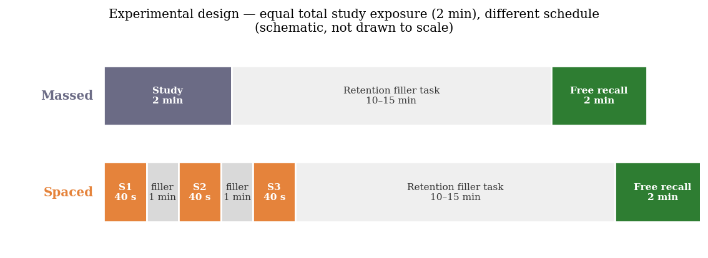
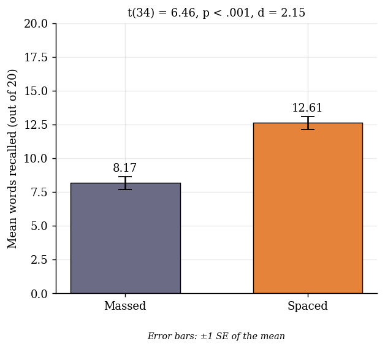
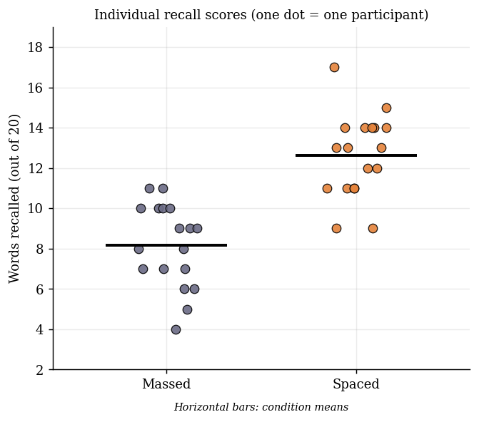
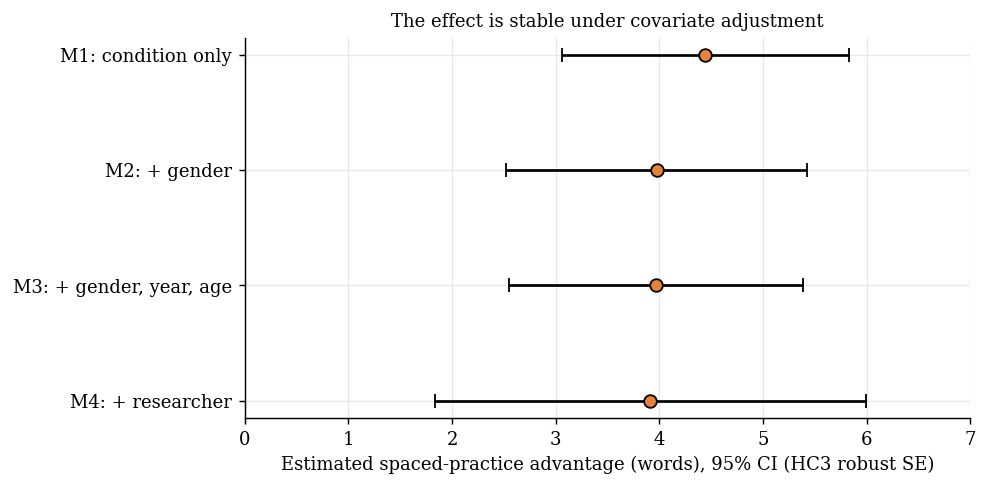

# The Spacing Effect: Spaced vs. Massed Practice and Word Recall

[](https://github.com/tanvirul-islam-rifat/spacing-effect-memory-experiment/actions/workflows/ci.yml)


A pre-planned, between-subjects **psychology experiment with a fully reproducible Python analysis pipeline**. 36 university students studied the same 20-word list for the same total time (2 minutes) — either in one massed block or in three spaced blocks — and were tested after a 10–15 minute delay. Conducted for **PSY101 — Introduction to Psychology** at BRAC University (August–September 2026).



## Headline Result

Participants who studied in **spaced** blocks recalled **4.44 more words** (12.61 vs. 8.17 out of 20; **+54%**) than those who studied in one **massed** block, with identical total study time.

| | Massed (n = 18) | Spaced (n = 18) |
|---|---|---|
| Mean recall (SD) | 8.17 (2.07) | 12.61 (2.06) |
| Median [min, max] | 8.5 [4, 11] | 13.0 [9, 17] |
| 95% CI of mean | [7.14, 9.19] | [11.59, 13.64] |

**Independent-samples t-test:** t(34) = 6.46, p < .001 · mean difference = 4.44 words, 95% CI [3.05, 5.84] · Cohen's d = 2.15 (approx. 95% CI [1.33, 2.97]). The null hypothesis was rejected in favour of the directional alternative (spaced > massed).

<p align="center">
  
  
</p>

Every spaced participant (18 of 18) scored above the massed mean, and 12 of 18 scored above the **highest** massed score — the advantage was broad-based, not driven by a few high scorers.

## Research Question and Hypotheses

> Does distributing study time into separate spaced sessions lead to better word recall than studying the same material in one continuous massed session among university students?

- **H₀:** no difference in mean words recalled between massed and spaced participants
- **Hₐ:** spaced participants recall significantly more words than massed participants (directional)

## Method at a Glance

| | |
|---|---|
| **Design** | True experiment, between-subjects, one independent variable (study schedule: massed / spaced) |
| **Dependent variable** | Words correctly recalled out of 20 (free recall, 2 minutes) |
| **Participants** | N = 36 university students (18 per condition), age 22–26, 26 male / 10 female, 2nd–4th year; convenience sample |
| **Materials** | 20 unrelated concrete nouns, arithmetic filler task, recall sheets, consent form, stopwatch |
| **Controls** | Same word list, same total study time (2 min), same retention interval (10–15 min filler), same recall time |
| **Allocation** | Random assignment to condition; the final allocation was balanced within each researcher's sessions (5/5, 5/5, 5/5, 3/3) |
| **Scoring** | Predetermined answer key; minor spelling errors accepted when the intended word was clear |

Full step-by-step procedure, stimuli and ethics: [`materials/EXPERIMENT_PROTOCOL.md`](materials/EXPERIMENT_PROTOCOL.md).

## Statistical Analysis

All results below are produced by [`analysis/analyze.py`](analysis/analyze.py) and written to [`results/`](results/) and [`figures/`](figures/).

**Assumptions.** Recall scores were normally distributed in both conditions (Shapiro–Wilk: massed W = .94, p = .339; spaced W = .95, p = .431) and variances were homogeneous (Levene F = 0.08, p = .784; SD ratio = 1.00), so the parametric independent-samples t-test was appropriate.

**Robustness checks** — the conclusion does not depend on the choice of test or on model adjustments:

| Check | Result |
|---|---|
| Welch t-test (unequal variances) | t(34.0) = 6.46, p < .001 |
| Mann–Whitney U (non-parametric) | U = 305, p < .001; probability of superiority = 0.94 |
| Permutation test (20,000 resamples, one-sided) | p < .001 |
| Bootstrap 95% CI for mean difference (10,000 resamples) | [3.17, 5.78] words |
| OLS adjusted for gender | +3.97 words, 95% CI [2.52, 5.42] |
| OLS adjusted for gender, year, age | +3.97 words, 95% CI [2.55, 5.38] |
| OLS adjusted for gender, year, age **and researcher** | +3.91 words, 95% CI [1.84, 5.99] |



**Group balance.** Year of study (p = .920) and age (p = .594) were balanced across conditions. Gender was *less* balanced — 2 of 10 women were in the massed group and 8 in the spaced group (Fisher exact p = .060) — which is why the adjusted models above matter: the effect shrinks slightly (4.44 → ~3.9 words) but remains large and clearly different from zero.

**Score distribution** (participants per score range):

| Score range | Massed | Spaced |
|---|---|---|
| 4–6 | 4 | 0 |
| 7–9 | 8 | 2 |
| 10–12 | 6 | 6 |
| 13–15 | 0 | 9 |
| 16–18 | 0 | 1 |

Additional figures: [score distribution](figures/03_score_distribution.png) · [bootstrap effect estimate](figures/04_effect_size_bootstrap.png) · [normality Q–Q plots](figures/06_normality_qq_plots.png). Full auto-generated report: [`results/analysis_summary.md`](results/analysis_summary.md).

## Interpretation

The result matches the **spacing effect** (Cepeda et al., 2006; Myers & DeWall, 2021): distributed study yields better retention than massed study of the same total duration. Because both groups had exactly two minutes of exposure, the difference cannot be attributed to study time — only to its distribution. Two mechanisms are consistent with the data and not distinguishable here: **encoding variability** (different contexts at each study episode create more retrieval cues) and **study-phase retrieval** (re-encountering an item after a gap forces retrieval rather than simple re-reading, linking the effect to the testing effect of Roediger & Karpicke, 2006).

## Limitations

- **Small, convenience sample** from one university; not representative of students in general.
- **Large effect from a small sample.** d = 2.15 is unusually large for a behavioural effect, and its confidence interval is wide (1.33–2.97). Small samples tend to give imprecise and often inflated estimates — a larger replication is needed before treating the magnitude as settled.
- **Short retention interval (10–15 min).** No evidence about retention over days or weeks, where spacing benefits are theoretically largest.
- **Low ecological validity.** Unrelated concrete nouns differ from real course material.
- **Unmeasured individual differences** (English proficiency, baseline memory, motivation, prior study habits) — randomisation addresses these as systematic confounds but does not quantify them.
- **Gender imbalance across conditions** (see above) and **experimenter effects** (4 researchers); both were handled with covariate-adjusted robustness models rather than by design.

**Future work:** 24-hour and 1-week delayed tests, meaningful academic material, systematically varied spacing intervals (Cepeda et al., 2008), a larger and more balanced sample, and measuring students' own judgments of how well each schedule works.

## Reproduce Everything

```bash
git clone https://github.com/tanvirul-islam-rifat/spacing-effect-memory-experiment.git
cd spacing-effect-memory-experiment
pip install -r requirements.txt

python analysis/analyze.py     # regenerates results/ and figures/
pytest -q                      # checks the pipeline reproduces every statistic in the paper
```

Continuous integration (GitHub Actions) runs the test suite and the full analysis on every push.

## Repository Structure

```
├── README.md
├── data/
│   ├── spacing_effect_data.csv        # pseudonymised dataset (N = 36)
│   └── DATA_DICTIONARY.md             # variables, provenance, de-identification steps
├── analysis/
│   ├── analyze.py                     # full pipeline: descriptives → tests → robustness → figures → report
│   └── prepare_data.py                # documents how the public CSV was derived from the (private) raw file
├── tests/test_analysis.py             # regression tests against the published statistics
├── results/                           # tables (CSV/JSON) and the auto-generated analysis summary
├── figures/                           # all figures (PNG)
├── materials/
│   ├── EXPERIMENT_PROTOCOL.md         # stimuli, procedure, variables, ethics
│   └── participant_consent_and_recall_form.pdf
├── docs/
│   ├── research_proposal.pdf
│   ├── final_paper_ids_redacted.pdf   # submitted paper (student ID numbers redacted)
│   └── NOTES_ON_SUBMITTED_PAPER.md    # corrections found while reproducing the analysis
└── .github/workflows/ci.yml
```

## Data Protection and Ethics

- Participation was voluntary with signed informed consent; participants could withdraw at any time. Recall sheets carried participant IDs, not names.
- The raw collection file (which contains names) is **not** in this repository. The published dataset contains no names, session dates, contact details or original participant IDs; IDs and researcher labels were re-randomised (see [`data/DATA_DICTIONARY.md`](data/DATA_DICTIONARY.md)).
- The hypothesis was withheld until the debrief to avoid demand characteristics; every participant received a full explanation immediately after the recall test.

## Notes on the Submitted Paper

While reproducing the analysis, one transcription error was found in the submitted paper's Table 2 (Spaced column), and the t and p values were absent from the text. Both are corrected here — see [`docs/NOTES_ON_SUBMITTED_PAPER.md`](docs/NOTES_ON_SUBMITTED_PAPER.md). All other reported statistics reproduce exactly.

## References

- Baddeley, A. D., & Longman, D. J. A. (1978). The influence of length and frequency of training session on the rate of learning to type. *Ergonomics, 21*(8), 627–635.
- Bahrick, H. P., Bahrick, L. E., Bahrick, A. S., & Bahrick, P. E. (1993). Maintenance of foreign language vocabulary and the spacing effect. *Psychological Science, 4*(5), 316–321.
- Cepeda, N. J., Pashler, H., Vul, E., Wixted, J. T., & Rohrer, D. (2006). Distributed practice in verbal recall tasks: A review and quantitative synthesis. *Psychological Bulletin, 132*(3), 354–380.
- Cepeda, N. J., Vul, E., Rohrer, D., Wixted, J. T., & Pashler, H. (2008). Spacing effects in learning: A temporal ridgeline of optimal retention. *Psychological Science, 19*(11), 1095–1102.
- Dunlosky, J., Rawson, K. A., Marsh, E. J., Nathan, M. J., & Willingham, D. T. (2013). Improving students' learning with effective learning techniques. *Psychological Science in the Public Interest, 14*(1), 4–58.
- Ebbinghaus, H. (1885/1913). *Memory: A contribution to experimental psychology.*
- Myers, D. G., & DeWall, C. N. (2021). *Exploring psychology* (12th ed.). Worth Publishers.
- Roediger, H. L., III, & Karpicke, J. D. (2006). Test-enhanced learning: Taking memory tests improves long-term retention. *Psychological Science, 17*(3), 249–255.

## Technical Architecture
- **Language:** Python 3.10+
- **Paradigm:** Scripted, reproducible statistical analysis pipeline (data validation → inference → robustness checks → reporting)
- **Libraries:** pandas, NumPy, SciPy, statsmodels, Matplotlib, pytest
- **Data Storage:** Flat-file CSV (pseudonymised); results as CSV/JSON/Markdown
- **Interface:** Command Line Interface (CLI) + GitHub Actions CI

## Core Engineering Practices Demonstrated
- **Experimental Design:** True between-subjects experiment with a manipulated independent variable, control condition, equal total exposure, and a fixed retention interval and recall protocol.
- **Statistical Inference:** Assumption checks (Shapiro–Wilk, Levene) before a parametric test; effect sizes (Cohen's d, Hedges' g), confidence intervals, and non-parametric, permutation and bootstrap confirmations.
- **Robustness Analysis:** Heteroskedasticity-robust (HC3) regression adjusting for gender, year, age and researcher after detecting a gender imbalance between conditions.
- **Reproducible Research:** One command regenerates every table and figure; a pytest suite asserts the pipeline reproduces the statistics reported in the paper; CI runs on every push.
- **Research Data Protection:** Raw identifiable data excluded from version control and `.gitignore`d; a documented, seeded de-identification script produces the public dataset; student IDs redacted from published documents.
- **Verification and Honest Reporting:** Reported results were independently re-computed from raw data; a table error was found, corrected and documented rather than hidden.

## Author
**Md. Tanvirul Islam Rifat**
- **GitHub:** [@tanvirul-islam-rifat](https://github.com/tanvirul-islam-rifat)
- **LinkedIn:** [Tanvirul Islam Rifat](https://www.linkedin.com/in/tanvirul-islam-rifat)

**Research team:** Md. Tanvirul Islam Rifat · Reeham Zyaan Khan · Sushnato Drobonti · Al-Takian Bin Faruque
